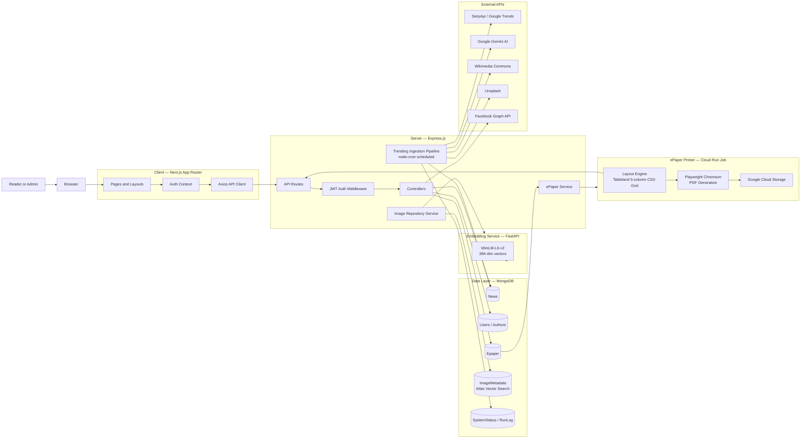
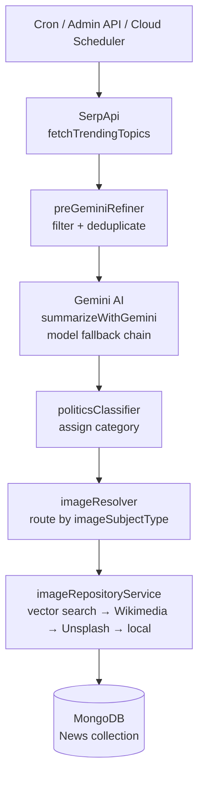
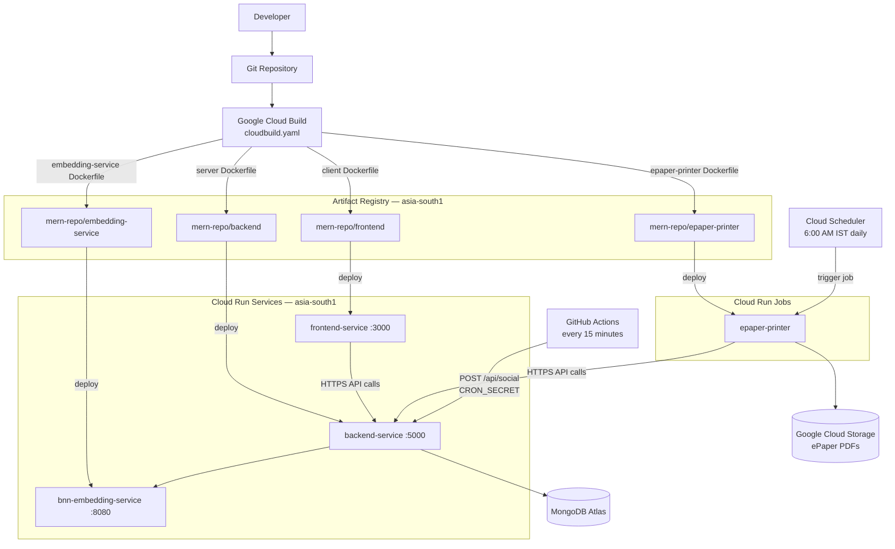

# Architecture and Deployment Diagrams

## 1. Application Architecture

## 2. Ingestion Pipeline

## 3. Deployment

## Notes

- The ePaper printer runs as a Cloud Run **Job** (batch, not a service). It is triggered by Cloud Scheduler daily or manually via `POST /api/epaper/trigger` from the admin dashboard.
- The embedding service is kept separate from Express to isolate Python ML dependencies and allow independent CPU scaling.
- Cloud Build injects `NEXT_PUBLIC_API_BASE_URL` as a Docker build arg into the client image.
- The backend fetches a GCP metadata service token when triggering Cloud Run Jobs — this only works when the server itself runs on GCP.
