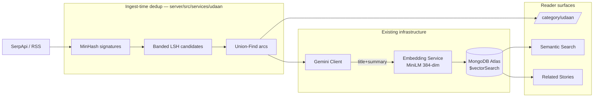

# Udaan — Innovation & Motivation Vertical

**Status:** Implemented
**Scope owner:** Pranav Napolean

---

## 1. Summary

Udaan is a ninth editorial vertical on BNN carrying innovation, founder, and grit
stories — the first BNN category that is not reactive news.

Two pieces of infrastructure make it viable: near-duplicate detection at ingest
(§2.2, §5), and semantic search / related-stories (§6) instead of plain
recency-in-category matching.

---

## 2. Business need

### 2.1 The gap

BNN currently runs eight other verticals — Politics, Business, Sports, Tech, World,
Entertainment, Bolta Hai Bharat, Editorial. All are reactive, and the majority carry
negative-valence content.

There is a demonstrated Indian readership for constructive news. The Better India,
YourStory, and Global Indian are established businesses serving exactly this appetite.
None of them are AI-first: their marginal cost per article is a salaried writer's time.
BNN's marginal cost per article is an API call.

That cost asymmetry is the commercial thesis for the vertical.

### 2.2 Why deduplication is a launch prerequisite

Innovation and motivation stories are **syndicated far more heavily than breaking
news**. A single story — "IIT Madras student builds a ₹5,000 prosthetic" — is
republished by dozens of outlets within a day. Without near-duplicate detection at
ingest, Udaan would launch as a handful of distinct stories repeated dozens of times.

---

## 3. Impact

### 3.1 User-facing surfaces

| Surface | Behaviour |
|---|---|
| **Verticals** | Nine total; Udaan is the first non-reactive one. |
| **Search** | `GET /api/news?mode=semantic&q=...` embeds the query and ranks results by meaning via MongoDB Atlas `$vectorSearch`. Falls back to the pre-existing keyword regex search on any failure (embedding service down, index missing), so semantic mode can never make search worse. |
| **Related Stories** | `GET /api/news/:id/related` ranks by semantic proximity when the story has an embedding; falls back to a plain category match otherwise. |
| **More you can read** | Unchanged — plain category match, pads with Politics if fewer than six matches exist. |
| **Story timeline** | Unchanged — a separate, Politics-only feature not part of Udaan. |
| **Provenance / citations** | Not built. |

### 3.2 Commercial impact

**Revenue.** Semantic recirculation raises pages per session against an ad integration
that is already live (`ca-pub-5612187899816278`).

**Cost.** Every duplicate that reaches Gemini is a wasted paid call, so deduplication
pays for itself before any quality argument.

**Risk.** Atlas vector search is one more external dependency (already true for image
search). Both semantic search and related-stories fail closed to pre-existing
behaviour rather than erroring visibly.

### 3.3 Known risks

1. **Lower CPM / lower urgency.** Motivation content monetises worse per view and
   gives less reason to return daily than politics.
2. **Deduplication threshold is a real trade-off.** Too aggressive and legitimate
   follow-up coverage gets suppressed. Currently a fixed threshold
   (`VERIFY_THRESHOLD = 0.5` in `server/src/services/udaan/index.js`);
   `server/bench/dedupBench.js` exists to sanity-check it against a true-pairwise
   ground truth if it's ever revisited.

---

## 4. Architecture

### 4.1 Pipeline



### 4.2 Registering the vertical

`category` on the News model is a free-form `String`, so no schema migration was
needed. Registration is one entry in `CATEGORY_FEEDS` in
`server/src/services/trending/ingestionConfig.js`:

```js
{
  id: 'udaan',
  topic: 'Udaan',
  query: 'India innovation grassroots founder social entrepreneur',
  category: 'Udaan',
  tags: ['innovation', 'motivation', 'grit'],
  timeRange: 'qdr:d7',       // wider than other feeds' default 24h — see §4.3
  freshnessHours: 168,
}
```

### 4.3 How a story actually gets into the tab

Two separate stages — an ingestion (write) path that runs on a schedule, and a
serving (read) path that runs on every page load.

**Stage 1 — ingestion.** The `query` string above is the entire "what counts as
Udaan" logic; there is no topic classifier beyond it. On every scheduled/triggered
run, `ingestCategoryFeeds` (`ingestionOrchestrator.js`) does, for the Udaan entry
same as every other `CATEGORY_FEEDS` entry:

1. `fetchCategoryArticles(feed)` (`serpApiClient.js`) — hits SerpApi's Google News
   tab with that query (`gl=in`, sorted by date), returns up to 8 raw articles.
   Udaan uses a 7-day window (`timeRange`/`freshnessHours` above) instead of the
   other feeds' 24h default — a niche topic on a 24h window returned a thin
   candidate pool, and widening it was a one-line fix with no new data source.
   If `UDAAN_RSS_ENABLED=true` (off by default), `fetchUdaanRssArticles()`
   (`udaanRssFeeds.js`) also pulls candidates from The Better India's and
   YourStory's RSS feeds, normalized to the same article shape and merged in
   before dedup — see §4.3.1.
2. `udaan.filterDuplicates(articles, {category})` — MinHash/LSH/Union-Find dedup
   (§5), *before* anything else. Splits into survivors (new stories) and duplicates
   (merged into an existing article's sources, dropped from further processing).
3. Top 3 survivors each go through `summarizeArticlesWithGemini` (title/summary/
   content synthesis) and `resolveBestImage`, then get saved via
   `News.findOneAndUpdate({primaryLink}, ...)` with `status:'published',
   category:'Udaan'`.
4. `udaan.registerArticle(record, article)` — MinHash signature, `arcId`/
   `isArcRepresentative`, and embedding (§6) all get set here.

Triggered by: the existing cron schedule (`refreshCategoryFeeds()`, same cadence as
the other 8 verticals), a manual admin call (`POST /api/news/trigger-ingestion`), or
— for testing a single feed in isolation — `npm run demo:trigger-udaan`.

**Stage 2 — serving.** `GET /api/news?category=udaan` → `getPublishedNews`
(`newsController.js`) → `News.find({status:'published', category:'Udaan'})
.sort({publishedAt:-1})`, paginated. No ranking, no filtering beyond that — plain
newest-first over whatever Stage 1 has accumulated so far.

So what shows up in the tab, at any point in time, is exactly: whatever SerpApi
(and, if enabled, RSS) returns for that one query string, that survived dedup, and
that got a good-enough Gemini synthesis — accumulated across however many
ingestion runs have happened.

#### 4.3.1 RSS supplement — flag-gated, off by default

`server/src/services/trending/udaanRssFeeds.js`, `UDAAN_RSS_ENABLED=true` to
enable. Pulls from `https://www.thebetterindia.com/feed/` and
`https://yourstory.com/feed`, normalized to the exact shape
`fetchCategoryArticles()` returns, so they flow through the same
dedup → Gemini → publish pipeline as SerpApi results, with per-feed error
isolation (one feed failing doesn't drop the other).

Why flag-gated rather than always-on: The Better India and YourStory are
themselves the incumbents named in the vertical's own business case (§2.1), so
pulling from their RSS feeds is closer to aggregating their coverage than
independent discovery — a different flavor of "sourcing" worth being able to turn
off if it doesn't feel right, without touching code. Also: YourStory in particular
skews toward general startup/funding/IPO news, not exclusively motivational
human-interest stories — the flag makes that a deliberate, reversible choice
rather than a silent default.

---

## 5. Deduplication + story arcs

`server/src/services/udaan/{minhash,lshIndex,unionFind,index}.js`:

- **MinHash** — 128-permutation signatures over 5-word shingles, so two articles'
  similarity can be estimated without comparing full text.
- **Banded LSH** — buckets signatures into 32 bands of 4 rows so only articles sharing
  a bucket become duplicate *candidates*, instead of comparing every pair.
- **Union-Find** — merges verified duplicate pairs into a "story arc"; the first
  article in an arc becomes the representative (the one that goes through Gemini and
  gets published), later duplicates get merged into its `sourceOptions` instead of
  triggering a new Gemini call.

Wired into `ingestCategoryFeeds` (`ingestionOrchestrator.js`) before any Gemini call,
for every category feed, not just Udaan.

`server/bench/dedupBench.js` and `server/bench/annBench.js` are informal
sanity-check scripts (true-pairwise ground truth vs. the LSH candidate generation),
useful if the threshold ever needs revisiting.

---

## 6. Semantic search + related stories

Reuses the pattern already in production for image search (`imageSearchService.js` +
`embeddingClient.js`) — no separate ANN index implementation, no retrieval agent.

1. **Embedding population.** `udaan.registerArticle()` embeds each article's final
   `title + summary` via the existing `EmbeddingClient` and stores it on
   `News.embedding`, for every category feed (sitewide, automatically). A one-time
   backfill for pre-existing articles: `npm run udaan:backfill:embeddings`
   (`server/scripts/backfillEmbeddings.js`).
2. **Atlas vector index.** `npm run udaan:index:news`
   (`server/scripts/createNewsVectorIndex.js`) creates the `$vectorSearch` index on
   `News.embedding` — the same shape as `scripts/createImageVectorIndex.js`.
3. **Search.** `GET /api/news?mode=semantic&q=...` embeds the query and runs
   `$vectorSearch`, falling back to the pre-existing regex search on any failure.
   Not paginated in the usual sense — `page`/`pages` are fixed at `1` for semantic
   results.
4. **Related stories.** `GET /api/news/:id/related` — vector search on the story's
   own embedding when present, falling back to a plain category match when it isn't.

---

## 7. Not built (explicitly out of scope)

- A hand-implemented ANN index (HNSW or otherwise) — Atlas `$vectorSearch` does this
  job.
- Agentic multi-hop retrieval / bounded beam search.
- Source citations / grounded generation — no provenance surfaces on articles.
- Story arcs as a reader-facing "follow" feature — the Union-Find arcs exist for
  dedup purposes only; nothing in the UI currently reads `arcId` beyond that.
- A formal benchmark/report deliverable — `bench/` scripts exist for sanity checks
  only.

---

## 8. Open questions

- Dedup threshold (`VERIFY_THRESHOLD = 0.5`, band config `b=32,r=4`) hasn't been
  re-tuned against real Udaan traffic.
- Whether "related stories" should eventually also read `arcId` (so a genuine
  follow-up story surfaces as related to its arc) rather than relying purely on
  embedding proximity.
